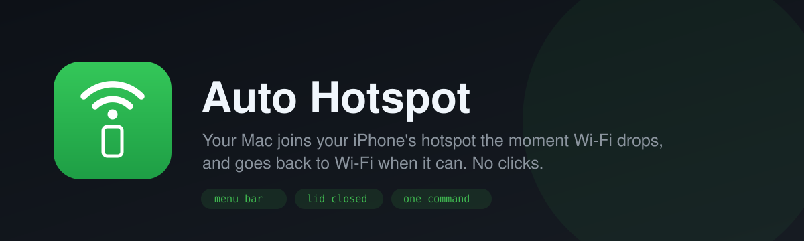
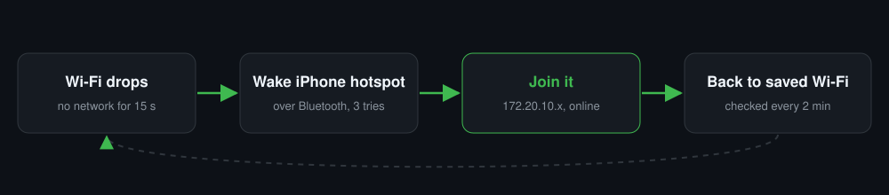
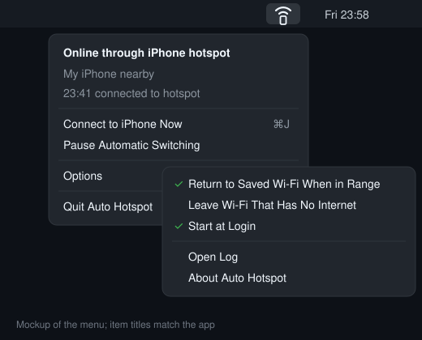

<p align="center"></p>

<p align="center">
  <a href="LICENSE"></a>
  <a href="https://github.com/samihalawa/mac-auto-hotspot/releases/latest"></a>
  
  <a href="https://github.com/samihalawa/mac-auto-hotspot/stargazers"></a>
</p>

**Auto Hotspot** is a small menu bar app for macOS. When your Mac loses its network, it asks
your iPhone to turn on Personal Hotspot and joins it, the same thing you would do by hand from
the Wi-Fi menu. When a saved Wi-Fi is back in range, it returns to it.

## Why

macOS already lists your iPhone under *Personal Hotspot* in the Wi-Fi menu, but it never picks
it on its own. Wi-Fi drops in a café, a train or a meeting room, and your downloads, calls, sync
and AI agents stall until you notice and click. Auto Hotspot does that click for you, within
about 20 seconds, including with the lid closed while the Mac keeps running.

<p align="center"></p>

## Quick start

```sh
curl -fsSL https://raw.githubusercontent.com/samihalawa/mac-auto-hotspot/main/install.sh | sh
```

This downloads the latest release, checks its SHA-256, installs `AutoHotspot.app` into
`~/Applications`, adds a login item so it starts with your Mac, and puts the icon in the menu bar.
Check it:

```sh
autohotspot --status
# link=1 internet=1 onHotspot=0 wifiOn=1 lidClosedOnBattery=0 paused=0 loginItem=1 knownWifiInRange=-
```

With Homebrew:

```sh
brew tap samihalawa/tap
brew install --cask autohotspot
```

Prefer a download? Get `AutoHotspot-<version>.dmg` from
[Releases](https://github.com/samihalawa/mac-auto-hotspot/releases/latest), drag it to
Applications and open it. It is signed with a Developer ID and notarized by Apple, so it opens
without a Gatekeeper warning. On first launch it adds its own login item.

**Requirements:** an iPhone signed in to the same Apple Account, with Bluetooth and Personal
Hotspot available (the same conditions as Apple's Instant Hotspot).

## The menu

<p align="center"></p>

| Item | What it does |
|---|---|
| Status line | Online through Wi-Fi, through the iPhone hotspot, Wi-Fi without internet, or no network |
| *iPhone nearby* | Whether your iPhone can be reached right now |
| Last event | The latest line from the log, with its time |
| **Connect to iPhone Now** (⌘J) | Turn on the hotspot and join it immediately |
| **Pause Automatic Switching** | Keep watching, but never switch on its own |
| Options → **Return to Saved Wi-Fi When in Range** | On by default. Every 2 minutes on the hotspot, looks for a saved Wi-Fi with a usable signal and goes back to it |
| Options → **Leave Wi-Fi That Has No Internet** | Off by default. Also switches when Wi-Fi is connected but dead or behind a login page for 30 s |
| Options → **Start at Login** | Adds or removes the login item |
| Options → **Open Log** | `~/Library/Logs/AutoHotspot.log`, one line per decision |

The icon follows the state: Wi-Fi, hotspot, Wi-Fi with a warning, no network, connecting, paused.
If your menu bar is full, macOS or a menu bar manager may tuck it behind the overflow arrow; drag it out with ⌘ held.

## Command line

The app binary is also a CLI (`~/.local/bin/autohotspot` after the script install):

| Command | Effect |
|---|---|
| `autohotspot --status` | Print what it sees now |
| `autohotspot --test` | Wake the iPhone's hotspot without joining it (exits 0 when the phone answers) |
| `autohotspot --force` | Turn on the hotspot and join it now |
| `autohotspot --headless` | Run the watcher without a menu bar icon |
| `autohotspot --version` | Print the version |

## How it behaves

- It acts only when macOS reports no network for 15 seconds. A working Wi-Fi is never left,
  unless you turn on *Leave Wi-Fi That Has No Internet*.
- Requests to the phone are retried 3 times, because the Bluetooth link often fails the first
  time. If the phone keeps failing it backs off to one attempt every 5 minutes.
- After the Mac wakes, cooldowns are reset so it reacts quickly in a new place.
- If it returns to a saved Wi-Fi that then fails, it does not try that Wi-Fi again for 15 minutes.
- Quitting from the menu stops it until the next login; if it crashes, it is restarted.

## Compared with

| | Auto Hotspot | Wi-Fi menu (built in) | [rucksack](https://github.com/mkrecny/rucksack) |
|---|---|---|---|
| Joins the iPhone hotspot automatically | Yes | No, a click each time | Keeps agents running on a hotspot; does not switch networks |
| Returns to saved Wi-Fi | Yes | Only when the hotspot ends | No |
| Menu bar status | Yes | Yes | No (CLI) |

## How it works

macOS's Sharing framework has a class, `SFRemoteHotspotSession`, that the Wi-Fi menu uses to
find your iPhone and turn on its hotspot. Auto Hotspot calls it, receives the network name and
password from the phone, and joins with `networksetup`. Network state comes from
SystemConfiguration (an iPhone hotspot always hands out `172.20.10.x`), and internet checks hit
`captive.apple.com`. It is one Objective-C file, [`Sources/main.m`](Sources/main.m).

`SFRemoteHotspotSession` is a **private API**: Apple can change it in any macOS release. Tested on
macOS 26 and 27 (Apple silicon). The class headers published in
[phatblat/macOSPrivateFrameworks](https://github.com/phatblat/macOSPrivateFrameworks) were the
starting point.

## Build from source

```sh
git clone https://github.com/samihalawa/mac-auto-hotspot && cd mac-auto-hotspot
./build.sh          # build/AutoHotspot.app, universal (arm64 + x86_64), macOS 13+
./build.sh dist     # also dist/*.zip, *.dmg and SHA256SUMS.txt
```

Or install from source in one go: `curl -fsSL https://raw.githubusercontent.com/samihalawa/mac-auto-hotspot/main/install.sh | sh -s -- --from-source`
(needs the Xcode command line tools).

## Uninstall

```sh
curl -fsSL https://raw.githubusercontent.com/samihalawa/mac-auto-hotspot/main/install.sh | sh -s -- uninstall
```

Removes the app, the login item, the CLI link and its settings. The log stays in `~/Library/Logs`.

## Limitations

- macOS only decides that the phone is "nearby" over Bluetooth; with Bluetooth off nothing happens.
- Joining uses `networksetup`; with some MDM profiles that restrict Wi-Fi changes it may be refused.
- The login item was tested by unloading and loading it and by killing the app; a full reboot was not run for this release.

## Contributing

Issues and pull requests are welcome; see [CONTRIBUTING.md](CONTRIBUTING.md).

## Licence

[MIT](LICENSE)
